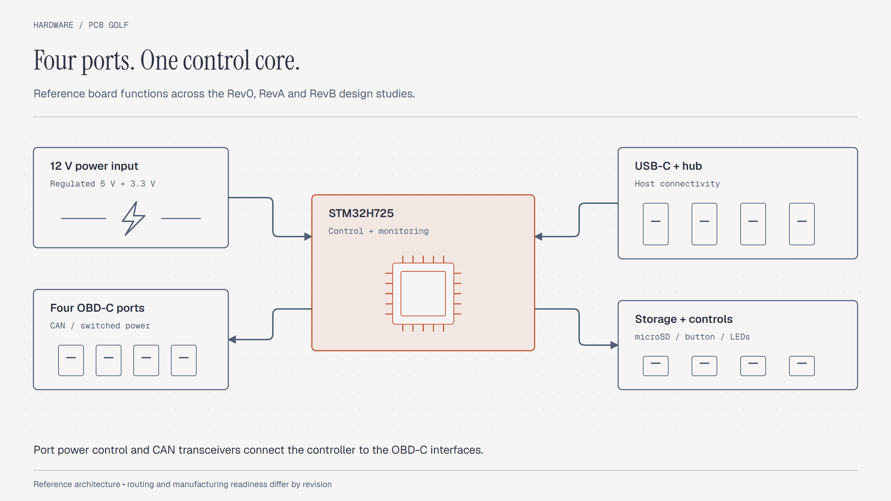

# PCBGolf — Compact Board Studies

PCB layout studies based on comma.ai's PCBGolf challenge. This repository contains reference files, EasyEDA projects, KiCad conversions, BOMs, and mechanical models.

The image above belongs to the upstream challenge material. It does not show a checked final submission from this repository.

## Project status

**The later design studies are incomplete. Do not treat them as fabrication-ready boards.**

[PARALLEL_DESIGN_STATUS.md](Rev%20B/PARALLEL_DESIGN_STATUS.md) records 239 unconnected connections in its selected four-layer study.
It also describes an unrouted two-layer placement. Neither study has a checked competition score.
Several status files refer to local `design/` and `work/` paths that are absent from this checkout.

## Reference system

The upstream reference combines these functions:

- A 12 V input with 5 V and 3.3 V supplies.
- Four OBD-C ports with controlled power and current monitoring.
- Four CAN transceivers and ignition simulation circuits.
- A USB hub and USB-C host connection.
- An STM32H725 microcontroller, microSD slot, button, and indicators.

Package substitutions and routing differ between revisions. Read each revision's notes before comparing the designs.

## Repository map

| Directory | Contents |
|---|---|
| [Rev 0](Rev%200/) | Upstream-style KiCad reference, libraries, STEP models, BOMs, and EasyEDA/Altium material |
| [Rev A](Rev%20A/) | Conversion and submission handoff artifacts |
| [Rev B](Rev%20B/) | EasyEDA handoffs, deliverables, BOMs, and routing-status reports |

Start with these engineering records:

- [Design status](Rev%20B/DESIGN_STATUS.md)
- [Four-layer status](Rev%20B/FOUR_LAYER_STATUS.md)
- [Routing studies](Rev%20B/ROUTING_STUDIES.md)
- [Saved parallel-design status](Rev%20B/PARALLEL_DESIGN_STATUS.md)
- [Rev A conversion instructions](Rev%20A/submission/KiCad%20files%20submission%20-%20Velan/READ-ME.txt)

## Open the design files

1. Select the revision you need.
2. Read its status and handoff notes.
3. Open `.kicad_pro` files with a compatible KiCad installation.
4. Import `.epro` or `.epro2` files with EasyEDA Pro or a compatible importer.
5. Check symbol and footprint libraries before changing the design.
6. Open STEP files in a mechanical CAD viewer.

Rev A requires a manual EasyEDA Pro project import for its native KiCad schematic and project.
Its supplied PCB conversion does not constitute a finalized submission.

## Review before fabrication

Complete routing, ERC, DRC, power-path analysis, thermal review, USB pair design, and mechanical checks.
Check connector access and component voltage ratings. Synchronize the schematic, PCB, BOM, and assembly model.

The challenge score combines assembled bounding-box volume, via count, and copper-layer count.
A bare-board outline alone cannot establish that score. The repository does not establish a current leaderboard position.

## Attribution and license

The reference design comes from [commaai/PCBGolf](https://github.com/commaai/PCBGolf).
[MIT](LICENSE) covers new documentation and eligible original contributions by Velan E.
It does not relicense the upstream board, supplied designs, challenge artwork, or third-party models.

The bundled KiCad library notice specifies CC-BY-SA 4.0 with a design-use exception.
Read [LICENSING.md](LICENSING.md) and the [original library notice](Rev%200/pcbgolf.3dshapes/KICAD_LIBRARY_LICENSE.md).
